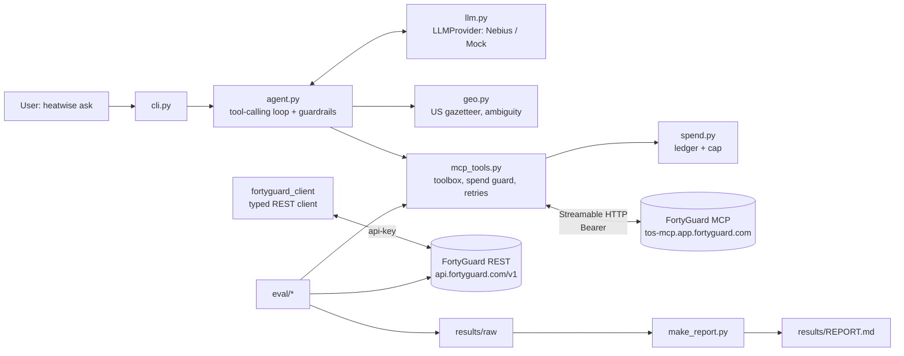

# heatwise

Independent evaluation project; not affiliated with or endorsed by FortyGuard. FortyGuard documentation is not included in this repo.

A heat-safety planner for outdoor events in US cities, built on the **FortyGuard Temperature MCP** and REST API. You ask a question in plain English; an LLM agent resolves the city, calls FortyGuard tools over MCP, and returns a structured answer (verdict, time window, confidence, caveats, data timestamp) together with every tool call it made.

The repo also contains a typed async REST client, an evaluation harness that ran against the live API and MCP, and the product feedback that came out of it. Every number in the reports comes from a saved raw response in `results/raw/`.

**Scope of the findings.** US locations only. Everything was tested with one evaluation API key (the server reported it as `premium`), and all findings come from my runs on 2026-11-20 (UTC). Results may differ for other keys, plans, locations or dates.

## 30-second demo

```powershell
# free: no paid FortyGuard call
.venv\Scripts\python -m heatwise ask "Is it safe to hold a 2pm outdoor event in Springfield on 2026-11-17? It was 20C." --non-interactive

# paid: one env_params call (2,900 credits on the key used here)
.venv\Scripts\python -m heatwise ask "Is it safe to hold a 2pm outdoor event in Phoenix on 2026-11-17? The air temperature was 19C." --non-interactive --yes
```

## Architecture



Guardrails enforced in code, not only in the prompt:
- **Ambiguous cities** (Springfield, Portland, Columbus...) are never picked silently. The agent asks, or must state the assumption; a final answer without it is rejected.
- **No invented inputs.** `env_params` needs a reference temperature. FortyGuard's tool description says never to invent it; heatwise blocks any call whose temperature did not come from the user or a heatmap result.
- **No verdict without data.** "safe/caution/unsafe" requires at least one successful data call.
- **Credits.** Every paid call goes through a ledger with a cap and an optional confirmation prompt. A paid call that fails in transit is not retried (it may have been charged; see Known issues).
- **Limits.** Max LLM steps, max tool calls, per-call timeout, retries with exponential backoff and jitter on retriable errors only; 403/429/quota stop the run.

## Setup (under 5 minutes)

Requirements: Python 3.11+, [uv](https://docs.astral.sh/uv/), a FortyGuard API key, and an OpenAI-compatible LLM key (Nebius Token Factory is the default).

```powershell
git clone <this repo>; cd heatwise
uv venv --python 3.12 .venv
uv pip install --python .venv\Scripts\python.exe -e ".[dev]"
Copy-Item .env.example .env      # then fill in TEMP_API_KEY and NEBIUS_API_KEY
.venv\Scripts\python -m pytest -q    # offline, no keys needed
```

`.env` is gitignored. Optional settings: `NEBIUS_MODEL` (default `Qwen/Qwen3-235B-A22B-Instruct-2507`, fixed for the evaluation), `HEATWISE_CREDIT_CAP` (default 150,000), `HEATWISE_LEDGER`.

Docker: `docker build -t heatwise .` then `docker run --rm --env-file .env heatwise ask "..." --non-interactive`.

CLI flags: `--temperature C` (your reference air temperature), `--yes` (auto-confirm paid calls), `--non-interactive`, `--max-steps N`, `--json`, `--trace-dir DIR` (saves the full tool conversation, redacted), `--verbose` (JSON logs on stderr).

## Example sessions (real output)

Copied from my local session captures (`--trace-dir` output and console logs). The session files themselves are not published because they contain full LLM conversations.

Ambiguous city, no credits spent:

```text
[step 1] thinking...
  -> resolve_city({'query': 'Springfield'})
  <- resolve_city: ok
[step 2] thinking...
  -> ask_user({'question': 'Which Springfield did you mean? Please choose from: Springfield, IL; Springfield, MA; Springfield, MO; Springfield, OH; or Spr...)
  <- ask_user: ok
I need one detail before I can answer:
  Which Springfield did you mean? Please choose from: Springfield, IL; Springfield, MA; Springfield, MO; Springfield, OH; or Springfield, OR.
  - Springfield, IL
  - Springfield, MA
  - Springfield, MO
  - Springfield, OH
  - Springfield, OR
Tool calls (2), model Qwen/Qwen3-235B-A22B-Instruct-2507, 2 steps, 0 credits:
  ok  local resolve_city
  ok  local ask_user
```

Forecast question, no credits spent:

```text
I need one detail before I can answer:
  You asked about tomorrow's coolest 3-hour window for a run in Austin, but future data is not available. Would you like me to find the coolest 3-hour window on a recent date instead, such as 2026-11-19?
```

Paid answer (the degree signs were garbled by the Windows console at capture time and are shown as captured):

```text
  -> env_params({'latitude': 33.4484, 'longitude': -112.074, 'temperature': 19, 'date_time': {'start_date': '2026-11-17', 'start_time': '14:00', 'filter_typ...)
  (auto-confirmed paid call: env_params, about 2900 credits)
  <- env_params: ok, 2900 credits
Verdict: SAFE (confidence: high)
The air temperature in Phoenix, AZ at 2:00 PM on 2026-11-17 was 19░C (66░F), with a heat index and apparent temperature near 19░C. Relative humidity was moderate at 45%, and solar irradiance was high (518 W/m▓ GHI), indicating strong sunlight. While heat risk is low, attendees may still feel warmth due to direct sun exposure.
Window: 2026-11-17T14:00:00-07:00 to 2026-11-17T15:00:00-07:00 (America/Phoenix)
Data timestamp: 2026-11-17T14:00:00-07:00
Tool calls (3), model Qwen/Qwen3-235B-A22B-Instruct-2507, 3 steps, 2900 credits:
  ok  local resolve_city
  ok  mcp   env_params credits=2900
  ok  local final_answer
```

The same paid question failed in transit on two later runs; heatwise stopped without retrying. See Known issues.

## Evaluation

Results: **[results/REPORT.md](results/REPORT.md)** (generated) and **[FRICTION_LOG.md](FRICTION_LOG.md)** (every snag with timestamp, reproduction and evidence file). Discovery notes: [docs/DISCOVERY.md](docs/DISCOVERY.md).

```powershell
# free (no credits)
.venv\Scripts\python eval\network_check.py 20
.venv\Scripts\python eval\errors_eval.py
.venv\Scripts\python eval\latency_eval.py 30
.venv\Scripts\python eval\consistency_from_raw.py
# paid: natural-language questions through the agent, one group at a time (30,000-credit section cap)
.venv\Scripts\python eval\mcp_questions.py 0
.venv\Scripts\python eval\mcp_questions.py 2 --no-paid --model openai/gpt-oss-120b   # free variant
# report and chart
.venv\Scripts\python eval\make_report.py --chart
```

`make setup / test / eval / report / demo` wrap the same commands where GNU make is installed.

**Docs check.** `eval/quickstart_verbatim.py` runs FortyGuard's API Quickstart as written. The Quickstart code is not included here. To re-run it, copy the Quickstart page text (both "Step 1" and "Step 2" with their code) from FortyGuard's docs (https://docs-api.fortyguard.com/docs) into `docs/source/quickstart.md`; the script reads the two steps from there. It submits one paid heatmap if the request is accepted.

**Published-copy changes.** One account identifier and one local folder path were redacted in two raw files, and the text of a FortyGuard-generated PDF was removed. Each change is listed in `FRICTION_LOG.md` under "Changes made for the published copy".

Raw files are never overwritten (exclusive create, timestamped names). `tests/test_report.py` fails if `results/REPORT.md` does not match a fresh regeneration from the raw files, and checks that the spend ledger reconciles with the measured credit balance.

## Known issues and limitations

- **Charged calls without a result.** 3 of 6 paid MCP calls ended with `MCPError: SSE stream ended without a response` and were still charged (verified by `credit_balance`). The cause (server, SDK or network) is not established. heatwise never retries these and books them as charged. Because of this, the paid MCP questions are only partly complete: the paid run was stopped early, and four planned questions and the paid consistency repeats were not run (see `FRICTION_LOG.md` F-22). I reported it to FortyGuard support.
- **Quickstart example rejected.** FortyGuard's Quickstart, run as written, gets HTTP 400 "outside supported U.S. coverage" for its lower-Manhattan example (F-29). heatwise's own examples use Phoenix, which worked.
- **No forecasts.** `env_params` rejects future dates, so "tomorrow" questions get an honest "not available".
- **Reference temperature.** `env_params` returns no air temperature of its own, and needs one as input; heatwise asks the user or derives it from a heatmap.
- **Gazetteer.** About 120 hand-compiled US cities with approximate coordinates; unknown cities are reported, not guessed. The optional geocoder fallback from the plan was not built.
- **Model quality.** With the primary model, 2 free-run answers misjudged a past date as "future" (reviewer notes in the report). The second model did not.
- **Not built:** n8n workflow (optional Task 8, not requested), rich CLI polish (Task 7), Anthropic provider (stub only). CI is defined in `.github/workflows/ci.yml` but has not run on GitHub (no remote). `make` was not available on the development machine; the commands were run directly.
- MCP client snippets for Claude Code, Cursor and Codex ([docs/MCP_CLIENTS.md](docs/MCP_CLIENTS.md)) are from FortyGuard's docs and were not tested in those clients.

## How this maps to the AI Automation Intern role

| Role requirement | Where |
|---|---|
| MCP servers | `src/heatwise/mcp_tools.py` (official SDK, Streamable HTTP, schema to function-calling conversion, error envelopes), `docs/MCP_CLIENTS.md` |
| AI agents, LLM tools | `src/heatwise/agent.py`, `llm.py` (swappable provider), structured `FinalAnswer` in `models.py` |
| APIs, JSON | `src/heatwise/fortyguard_client/` (typed async client, retries, TTL cache, rate-limit headers), Pydantic models from real responses |
| Webhooks, workflow automation, n8n | Not built in this scope (optional Task 8). The REST client and rate-limit findings are the building blocks for it. |
| Evaluation and product feedback | `eval/`, `results/REPORT.md`, `FRICTION_LOG.md` |
| Working with coding agents | `AGENTS.md`, `CLAUDE.md`, `.cursor/rules/heatwise.mdc` |

## Repo layout

```text
src/heatwise/          agent, CLI, MCP layer, LLM providers, gazetteer, settings, spend ledger
src/heatwise/fortyguard_client/   typed REST client
tests/                 offline tests (fixtures built from real captures by tests/fixtures/_build.py)
eval/                  probes and evaluation scripts, questions.json, mcp_reviews.json, make_report.py
results/raw/           raw captures (redacted); results/REPORT.md, latency.png, spend_ledger.jsonl
                       (not published: the PDF returned by the report call, and LLM session traces)
docs/                  DISCOVERY.md, EVAL_PLAN.md, MCP_CLIENTS.md
```
